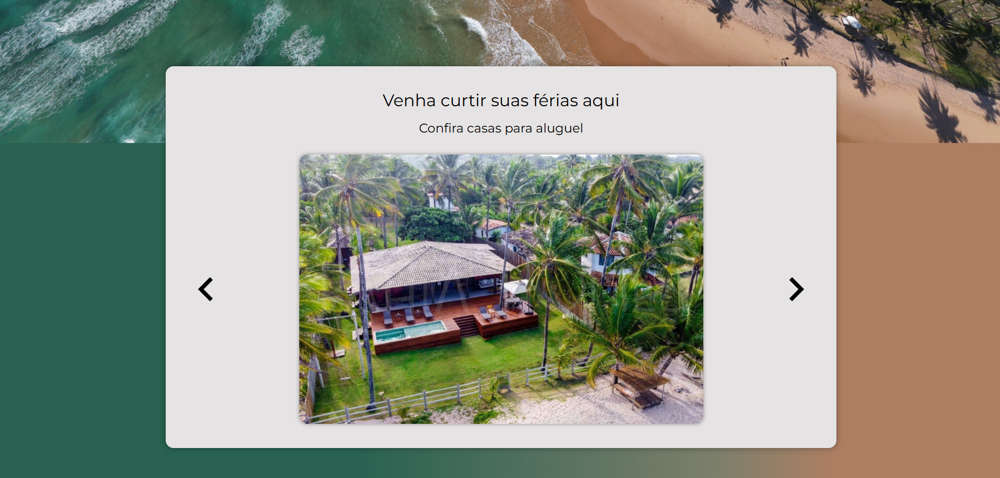

# Vacation Rentals Website — Praxis Jr Final Project

A responsive multi-page website for vacation home rentals, built with **HTML, CSS and JavaScript** as the final project of the Praxis Jr trainee program. It was developed for educational purposes and simulates a platform for presenting properties for rent.

## Screenshots



## Pages

| Page | File |
| --- | --- |
| Home | `index.html` |
| Homes | `homes.html` |
| Contact | `contact.html` |

## Features

- Home page with an image carousel and contact information
- Listing page with photos and detailed descriptions of each house
- Contact page with phone, e-mail, social media and address
- Responsive layout, with dedicated stylesheets for each page

## Tech stack

- HTML5
- CSS3
- JavaScript
- Google Fonts (Montserrat, Roboto)

No frameworks and no build step.

## Running locally

```bash
git clone https://github.com/brunocmg/vacation-rentals-website.git
```

Then open `index.html` in your browser.

## Project structure

```
.
├── index.html
├── homes.html
├── contact.html
├── assets/
│   ├── css/
│   │   ├── style_main.css
│   │   ├── style_homes.css
│   │   ├── style_contact.css
│   │   ├── responsividade_main.css
│   │   ├── responsividade_homes.css
│   │   └── responsividade_contact.css
│   ├── js/
│   │   ├── index.js
│   │   └── homes.js
│   └── img/
└── docs/     
```

## Team

- [Bruno Gomes](https://github.com/brunocmg)
- Adrian Bryan
- Erick Santos
- Thiago Sampaio
- Ian Menezes
